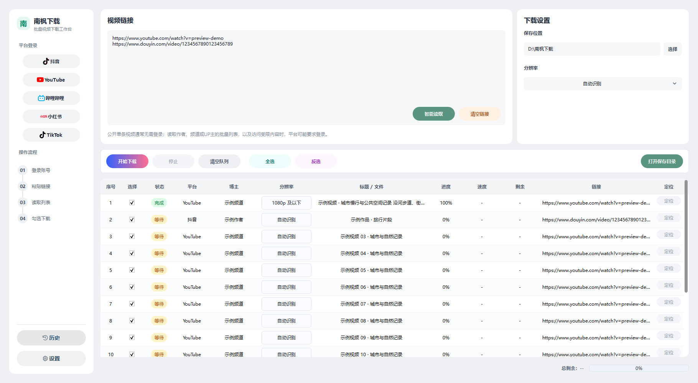
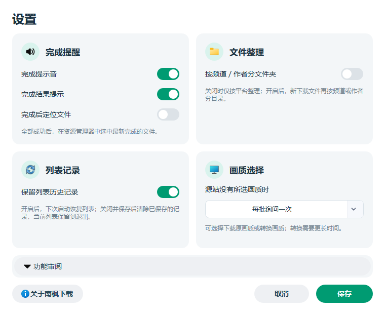
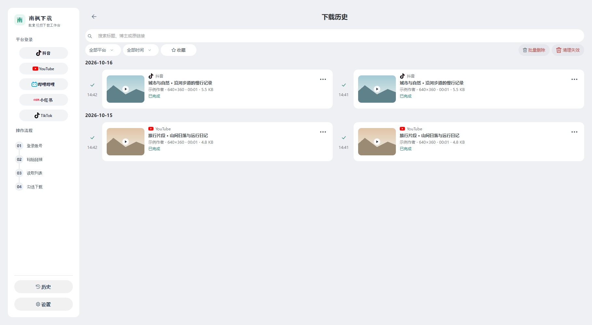

# 南枫下载

面向个人批量工作流的抖音 / YouTube / 哔哩哔哩 / 小红书 / TikTok / Pornhub Windows 桌面下载工具。当前源码使用 Python、PySide6、yt-dlp、Playwright 和 FFmpeg。

当前行为与维护入口见 [合同索引](docs/contracts.md) 和 [开发入口](docs/context.md)；源码／测试／发布状态见 [项目状态](docs/PROJECT_STATUS.md)。[历史开发审计](docs/app-development-experience-audit.md) 保留其注明日期的经验与证据。

## 界面预览







预览来自 Windows v2026.10.16.2 的冻结 EXE 实际运行界面：主工作台 1820 × 1000、设置页 760 × 620；队列与历史为脱敏演示数据，历史封面来自合成风景媒体，未启动公网下载。

## 下载安装

Windows 安装包：[v2026.10.16.2](https://github.com/nanzhufeng/NanfengDownloader-Windows/releases/tag/v2026.10.16.2-windows)，使用 Inno Setup 7 构建。更新内容见[版本说明](docs/release-2026.10.16.2.md)，验证进度见 [项目状态](docs/PROJECT_STATUS.md)。

Windows 版本按默认规则以未签名安装包发布，Windows SmartScreen 可能显示“未知发布者”；请确认下载地址后安装。

## 能力边界

- 支持公开内容，以及登录后当前账号本来有权限访问的内容。
- 不支持会员、付费、DRM、私密内容或访问权限绕过。
- 不在软件里填写或保存账号密码。
- 软件内登录使用独立持久浏览器资料目录；历史 Cookie 按平台保留为 Windows 当前用户可解密的 DPAPI 加密快照，下载器只临时读取目标平台自己的副本，不再聚合跨平台会话。
- 外部平台仍可能基于网络、地区、IP 或账号行为要求验证，软件不会把平台限制伪装成本地修复成功。

## 当前功能

- 以下能力描述对应当前源码；已发布安装包的范围以版本说明为准。通用网站作品页、音视频直链与已识别集合按各自语义处理，见 [通用下载合同](docs/generic-download.md)。
- 智能识别抖音、YouTube、哔哩哔哩、小红书和 TikTok 的单视频及作者/频道/UP 主链接；支持包含短链的 Mac/移动端抖音分享文本，B站多 P 选集会展开为可勾选的独立队列项。
- TikTok 支持单视频、分享文本和作者主页，使用独立软件内登录资料，列表只保留目标作者作品。
- 小红书只把视频笔记加入队列，图文笔记不会伪装成视频；作者页被平台遮蔽时会明确提示软件内登录。
- Pornhub 支持公开单视频链接直接入队；不承诺会员、私密或 DRM 内容，也不把该站链接误交给 YouTube 解析。
- 下载完成后可在对应队列行点击“定位”，直接打开 Windows 资源管理器并选中该任务的准确输出文件。
- 链接输入区提供独立“清空链接”按钮，只清空输入内容，不影响已经读取的下载队列。
- 单视频只加入一条；集合链接读取可勾选作品列表。B站明确 p= 只读指定分 P；不带 p 的多 P 页面保留选集。
- 抖音与 YouTube 单作品快速入队；抖音短链只解析跳转身份，完整标题、作者和媒体地址在下载时获取；不会为入队重复启动媒体嗅探。
- 支持自动识别最佳可用画质、1080p／720p／360p 上限和仅音频 MP3。
- 支持每行单独修改分辨率、全选、反选和执行前重新检查勾选。
- 默认只按平台建立目录，文件名优先使用发布时间加标题；可在设置中开启按频道/作者分文件夹。
- 下载历史：左侧“历史”打开完整历史页，支持搜索、平台／时间筛选、视频收藏、播放定位与批量管理。删除历史记录保留本地文件；清空队列不清除历史。详见[下载历史说明](docs/download-history.md)。
- 按任务目标身份检查并跳过本地已有有效媒体，不凭相似列表标题或目录里有其他文件判断成功。
- 显示进度、速度、剩余时间、等待联网、失败、停止、跳过和完成状态。
- 网络恢复后自动继续；停止信号会中断 yt-dlp 进度回调、抖音分块读取和 FFmpeg 子进程。
- 最终输出通过 ffprobe 或媒体文件头验证，网页、JSON、空文件和伪 mp4 不会标记为成功。

## 启动

安装依赖：

```powershell
python -m pip install -r requirements.txt
```

开发启动：

```powershell
python start.py
```

也可以双击 `启动南枫下载.bat`。

## 自动验证

```powershell
python -m unittest discover -s tests -v
python -m compileall -q app tests scripts
```

真实平台回归与持续平均速度报告：

```powershell
python scripts/run_real_download_regression.py `
  --youtube-single "https://www.youtube.com/watch?v=PONo81nwVy4" `
  --douyin-single "<当前可访问的抖音单视频链接>" `
  --douyin-author "<当前可访问的抖音作者链接>" `
  --bilibili-single "<当前可访问的 B站单视频链接>" `
  --bilibili-space "<当前可访问的 B站 UP 主空间链接>" `
  --xiaohongshu-single "<当前可访问的小红书视频笔记链接>" `
  --xiaohongshu-author "<当前可访问的小红书作者主页链接>" `
  --tiktok-single "<当前可访问的 TikTok 单视频链接>" `
  --tiktok-author "<当前可访问的 TikTok 作者主页链接>" `
  --require-douyin
```

真实回归会下载单视频样本、验证媒体、记录目录读取耗时和持续平均速度；作者/频道链接只验证目录语义，避免误触发整批下载。输出保存在 `.verification-downloads/`，报告写入 `docs/verification/real-download-latest.json`，两者默认不进入 Git。

## Windows 独立源码

本仓库已是独立 Windows 源码根；不要从旧的混合历史目录发布 Windows 安装包。

## Windows 打包

先通过源码或 `.bat` 验证，再按需执行：

```powershell
python -m PyInstaller --noconfirm 南枫下载_Windows.spec
```

发布到 GitHub 时优先使用 Inno Setup 安装包：

```powershell
powershell -ExecutionPolicy Bypass -File scripts\build_windows_installer.ps1 -Version 2026.10.13
```

构建脚本默认使用 Inno Setup 7 x64；仅在 7 未安装时回退到 Inno Setup 6。

示例日期需替换为准备发布的新版本，并先同步 `app/main.py` 的 APP_VERSION 和实际开发时间；本地与云构建会核对软件“关于”版本与发行参数一致。安装器名称和 GitHub 标签由同一元数据生成，已存在的正式标签／产物会被拒绝而不是覆盖。构建先写入隔离工作目录，只有安装包完整生成后才进入 `D:\ReleaseUpload\NanfengDownloader`，中断产物不会伪装为正式 Release。安装范围为当前 Windows 用户，卸载不会删除下载目录或软件专用登录资料；更新前请正常关闭正在下载的南枫下载，安装器不会强制结束下载任务。

打包前应确认 FFmpeg、Node.js 和 YouTube PO Provider 被正确发现；最终还需验证 EXE 启动、产品名、品牌图标、依赖和安装包。
